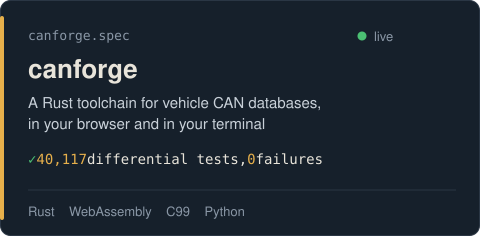
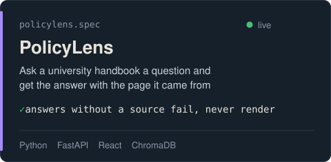
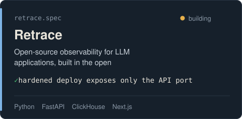
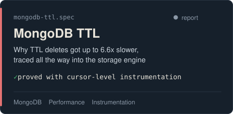

<!-- You opened the source. That's the kind of curiosity I like. Say hi at patil.swaraj@northeastern.edu -->

  

I build software people depend on, then I prove it works.

  <a href="https://swarajpatil.vercel.app/"><b>Portfolio</b></a>&nbsp;&nbsp;&nbsp;&nbsp;
  <a href="https://www.linkedin.com/in/swaraj1703"><b>LinkedIn</b></a>&nbsp;&nbsp;&nbsp;&nbsp;
  <a href="mailto:patil.swaraj@northeastern.edu"><b>Email</b></a>

### Things I've built

  
  

  
  

### What I'm working on

- An LLM pipeline that maps messy data files onto clean schemas, for my Master's Project at Northeastern
- New features for [MSstatsShiny](https://msstats.org/msstatsshiny/), an open-source app biomedical researchers use worldwide
- [Retrace](https://github.com/Swaraj-Patil/retrace), in the open, one commit at a time

### What I work with

`Python` `TypeScript` `Rust` `C` `SQL` `React` `Next.js` `FastAPI` `NestJS` `PostgreSQL` `AWS` `Docker`

<b>For recruiters, the 30-second version</b>

 

- MS in Computer Science at Northeastern, graduating December 2027
- Five years of production software for banks, insurance agencies and a Fortune 500 biotech
- Based in Boston and happy to relocate
- The fastest way to reach me is [patil.swaraj@northeastern.edu](mailto:patil.swaraj@northeastern.edu)

